# Home-Net

Ein Baukasten für Dienste im Heimnetz, lauffähig auf jedem Linux mit Docker. Du wählst bei der Installation oder später,
welche Module du nutzt. Der Plan steht in [docs/PLAN.md](docs/PLAN.md).

*English: see [README.en.md](README.en.md).*

## Installieren

Auf einem Linux mit Docker und Compose:

```bash
git clone https://github.com/Archonw/Home-Net.git
cd Home-Net
./home-net install
```

Das Programm fragt nach Datenordner, Modulen und Passwort. Danach läuft alles unter `http://<rechner>:8093`, mit einer Anmeldung für alle Module.

Aus einem eigenen Fork installiert, holt Home-Net Updates, Container und App aus diesem Fork (siehe
[docs/APP-UPDATES.md](docs/APP-UPDATES.md#eigener-fork)).

### Versionen und Updates

Es gibt zwei Kanäle:

- **stabil** (Standard): die höchste veröffentlichte Version `vX.Y.Z`. Die Container kommen fertig gebaut für amd64 und
  arm64 von `ghcr.io/archonw/home-net`, die Installation dauert darum nur Minuten und läuft auch auf einem Raspberry Pi.
- **main**: der neueste Stand des Codes, die Container werden auf dem eigenen Rechner gebaut. Für Tester und Entwickler.

`./home-net update` holt die neue Version, `./home-net version` zeigt die laufende, `./home-net kanal main` bzw.
`./home-net kanal stabil` wechselt den Kanal. Zurück zu einer älteren Version: `./home-net update --version v1.0.0`.
Die Änderungen jeder Version stehen unter **Releases**.

| Befehl | Wirkung |
| --- | --- |
| `./home-net modules` | Zeigt die verfügbaren Module |
| `./home-net add <modul>` / `remove <modul>` | Modul ergänzen oder stoppen, seine Daten bleiben. `add pc-sicherung --dir <ordner>` legt fest, wohin die PC-Sicherungen kommen |
| `./home-net status` | Zeigt, was läuft |
| `./home-net update` | Lädt die neue Version von GitHub und startet neu. Schlägt der Download fehl, bleibt die alte |
| `./home-net version` / `kanal [stabil\|main]` | Zeigt die Version, wechselt den Kanal |
| `./home-net password` | Ändert das Passwort |
| `./home-net heimnetz` | Zeigt oder ändert, welche Netze als Heimnetz gelten (Anmeldung nur mit Passwort) |
| `./home-net backup` / `restore <archiv>` | Sichert Einstellungen und Geheimnisse oder spielt sie zurück |

## So sieht die App aus

Alle Bilder zeigen erfundene Beispieldaten. Sie entstehen im Emulator mit `tools/app_screenshots.py` (Workflow
*Screenshots*), dann passen sie immer zur aktuellen App.

| Startseite | Netzwerk | Pi-Wartung | PC-Sicherung |
| --- | --- | --- | --- |
| 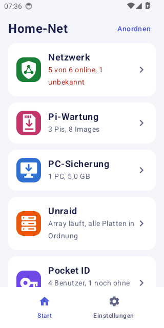 | 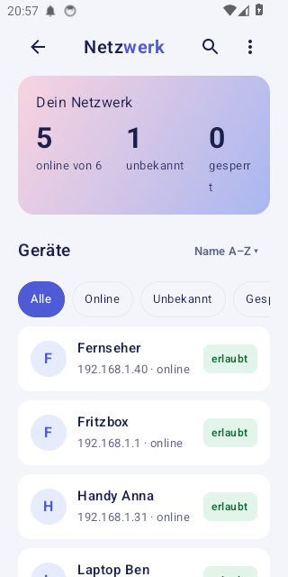 | 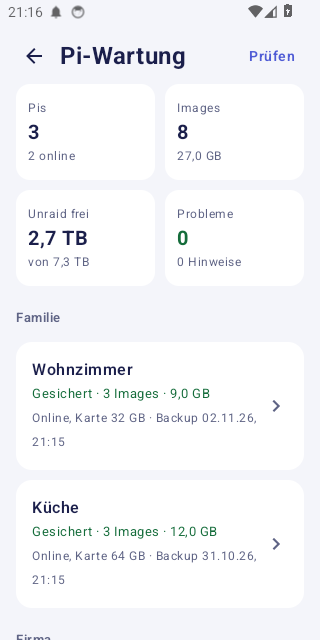 | 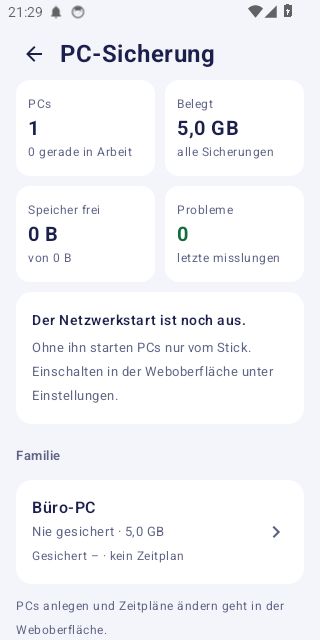 |

| Unraid | Pocket ID: Benutzer | Pocket ID: Apps zuordnen | Pocket ID: Einladung |
| --- | --- | --- | --- |
| 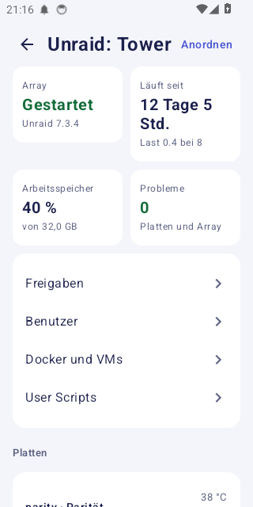 | 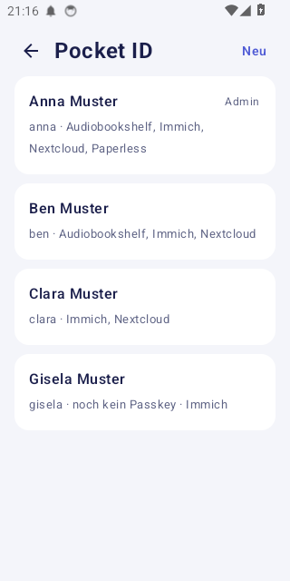 | 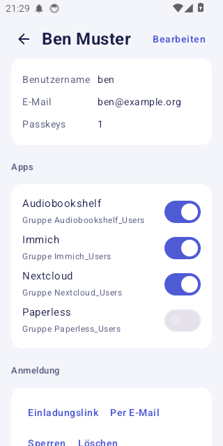 | 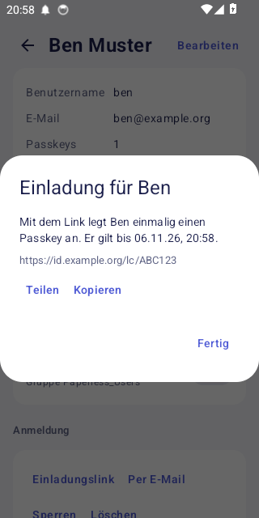 |

| Proxy Manager: Adressen | Proxy Manager: Zertifikate |
| --- | --- |
| 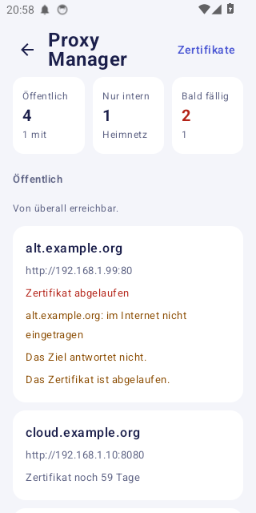 | 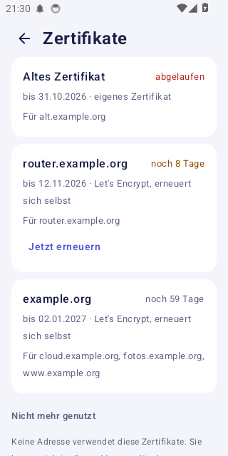 |
| WireGuard: Zugänge | WireGuard: QR-Code |
| --- | --- |
| 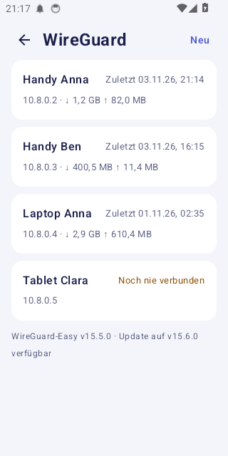 | 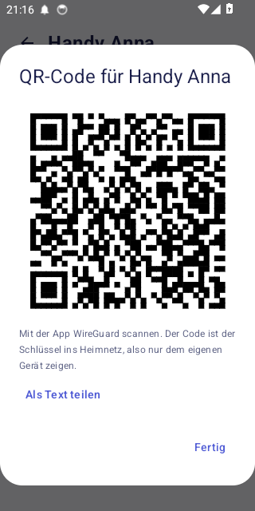 |

| Pi-hole | Pi-hole: pausiert | Pi-hole: Statistik | Pi-hole: ein Gerät |
| --- | --- | --- | --- |
| 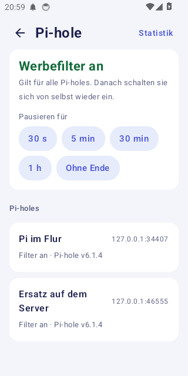 | 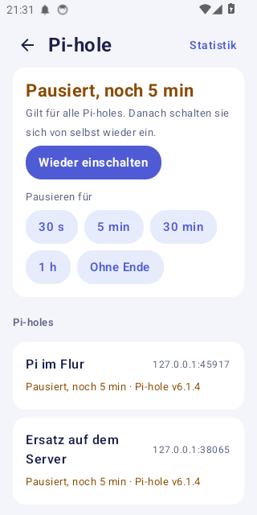 | 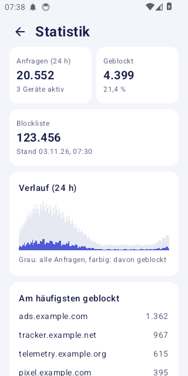 | 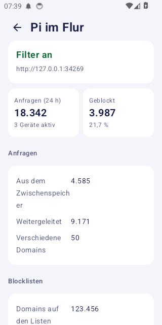 |

## Konten und Anmeldung

Jeder meldet sich mit Benutzername und Passwort an. Im Heimnetz reicht das, von außen, über einen Reverse Proxy mit HTTPS, gehört ein Passkey dazu.

- **Was als Heimnetz gilt:** Die Installation merkt sich die Netze, mit denen der Rechner verbunden ist, und die Wege, auf
  denen Nutzer eines VPN-Containers wie WireGuard-Easy ankommen. Nur Geräte aus diesen Netzen melden sich mit dem Passwort allein an. Alles, was über
  einen Reverse Proxy oder Tunnel kommt (Nginx Proxy Manager, Cloudflare Tunnel, Tailscale Funnel, ngrok), gilt immer als
  „von außen“, auch wenn der Tunnel auf demselben Rechner läuft. `./home-net heimnetz` zeigt die Liste,
  `./home-net heimnetz 192.168.1.0/24,10.8.0.0/24` setzt sie, `auto` erkennt sie neu.

- **Rollen:** Der Eigentümer darf alles. Admins verwalten Benutzer. Benutzer sehen nur die Dienste und Pi-Kategorien, die ihnen freigegeben sind.
- **Gruppen:** Unter **Benutzer → Gruppen** fasst du Konten zusammen, z. B. „Schule“. Jedes Mitglied bekommt die Dienste und Pi-Kategorien der Gruppe zusätzlich zu seinen eigenen; wer die Gruppe verlässt, verliert sie sofort wieder.
- **Passkey einrichten:** Unter **Benutzer** die Adresse für unterwegs speichern, unter **Mein Konto** einen Code holen und auf dieser Adresse `/login` öffnen. Die Wiederherstellungscodes aufbewahren.
- **Benachrichtigungen:** Jedes Konto wählt unter **Mein Konto** oder in der App unter **Einstellungen → Benachrichtigungen**, welche Meldungen es möchte. Es bekommt nur Meldungen zu Diensten und Pi-Kategorien, die es sehen darf. Die gekoppelte App empfängt sie über eine Verbindung im Hintergrund direkt vom eigenen Server, ohne Dienste von Google; ntfy ist dafür nicht nötig. Hat das Handy Internet, der Server aber 15 Minuten lang nicht geantwortet, warnt die App von selbst, sofern eine Adresse für unterwegs eingetragen ist.
- **App koppeln:** Unter **Mein Konto** einen Kopplungscode holen und in der App unter **Einstellungen → Zugang** eintragen. Geräte lassen sich einzeln entfernen.
- **Protokoll:** Anmeldungen und Änderungen stehen unter **Protokoll**.
- **Passwort vergessen:** `./home-net password <konto>` auf dem Server.

Der Port von Home-Net darf nicht direkt ins Internet weitergeleitet werden, sondern nur über den Proxy.

## Aufbau

| Ordner | Inhalt |
| --- | --- |
| `core/` | Installationsprogramm und gemeinsamer Zugang |
| `android/` | Android-App, zeigt eine Kachel je Modul |
| `modules/netzwerkmonitor/` | Überwacht die Geräte im Netz, mit FritzBox auch Sperren, siehe [README](modules/netzwerkmonitor/README.md) |
| `modules/pi-wartung/` | Sichert Raspberry Pis als Images, die sich auf SD-Karten schreiben lassen |
| `modules/pc-sicherung/` | Sichert ganze PCs (Windows, Linux, beides) über den Netzwerkstart und stellt sie wieder her, siehe [README](modules/pc-sicherung/README.md) |
| `modules/unraid/` | Verwaltet den Unraid-Server: Freigaben, Benutzer, Einstellungen, Docker, VMs und User Scripts, siehe [README](modules/unraid/README.md) |
| `modules/pocket-id/` | Verwaltet die Benutzer von Pocket ID (Anmeldung mit Passkey): anlegen, einladen, sperren, Apps zuordnen, siehe [README](modules/pocket-id/README.md) |
| `modules/proxy-manager/` | Zeigt, welche Adressen Nginx Proxy Manager von außen erreichbar macht, welche nur intern sind und wann die Zertifikate ablaufen, siehe [README](modules/proxy-manager/README.md) |
| `modules/pocket-id-server/` | Installiert Pocket ID selbst, falls noch keins läuft (`home-net add pocket-id --with-server`) |
| `modules/wireguard/` | Verwaltet die VPN-Zugänge von WireGuard-Easy: anlegen, sperren, QR-Code fürs Handy in der App, siehe [README](modules/wireguard/README.md) |
| `modules/wireguard-server/` | Installiert WireGuard-Easy selbst, falls noch keins läuft (`home-net add wireguard --with-server`) |
| `modules/pihole/` | Pausiert den Werbefilter aller Pi-holes gleichzeitig und zeigt ihre Statistik zusammen, siehe [README](modules/pihole/README.md) |
| `modules/ntfy/` | Eigener Server für Benachrichtigungen |
| `tools/` | Hilfsprogramme, zum Beispiel die Sicherung der Einstellungen |
| `assets/icons/` | Logos |
| `docs/` | Plan und Bilder der App |

## Android-App: Installation und Updates

GitHub Actions baut bei jedem Push die APK. Nach einem Push auf `main` liegt sie unter **Releases** als
`netzwerkmonitor.apk`. Home-Net holt neue Versionen selbst und bietet sie unter `https://<home-net>/app` und in der App
an, auch ohne Netzwerkmonitor. Details, Obtainium und eigene Forks: [docs/APP-UPDATES.md](docs/APP-UPDATES.md).

Signiert wird mit den Secrets `NETMON_KEYSTORE_BASE64`, `NETMON_KEYSTORE_PASSWORD`, `NETMON_KEY_ALIAS` und
`NETMON_KEY_PASSWORD`. Den Signierschlüssel und sein Passwort sicher aufbewahren: Ohne sie gehen Updates der App nur
per Neuinstallation.

## Umzug auf einen neuen Rechner

`./home-net backup` sichert Einstellungen und Geheimnisse, `./home-net restore <archiv>` spielt sie auf dem neuen Rechner
ein. Die Images der Pis und die PC-Sicherungen liegen in ihren eigenen Ordnern und brauchen eine eigene Kopie.

## Logos

In `assets/icons` liegen die Logos als SVG und PNG: `home-net` für die App und die Gruppe auf dem Unraid, `netzwerk`,
`pi-wartung` und `pc-sicherung` für die Dienste. Die Container auf dem Unraid laden sie von hier.

## Eine Version veröffentlichen

Unter **Actions → Release → Run workflow** die neue Nummer eintragen (`v1.2.0`), oder ein Tag `v1.2.0` pushen. Der
Workflow baut alle Container für amd64 und arm64, legt sie auf `ghcr.io/archonw/home-net/<container>` und erstellt das
Release mit den Änderungen seit der letzten Version. Die Pakete auf ghcr.io müssen einmalig öffentlich gestellt werden.

## Ein Modul hinzufügen

Ein Modul ist ein Ordner unter `modules/` mit einer `module.json`: Name, Logo, Container, Rechte und Schnittstelle. Der Kern
baut daraus die Installation und den Zugang. Die Anleitung steht in [docs/MODULE.md](docs/MODULE.md).

## Mitmachen und Sicherheit

Fehler und Wünsche gern als Issue, Änderungen als Pull Request: [CONTRIBUTING.md](CONTRIBUTING.md). Sicherheitslücken
bitte vertraulich melden, siehe [SECURITY.md](SECURITY.md).

## Lizenz

[Apache License 2.0](LICENSE)
